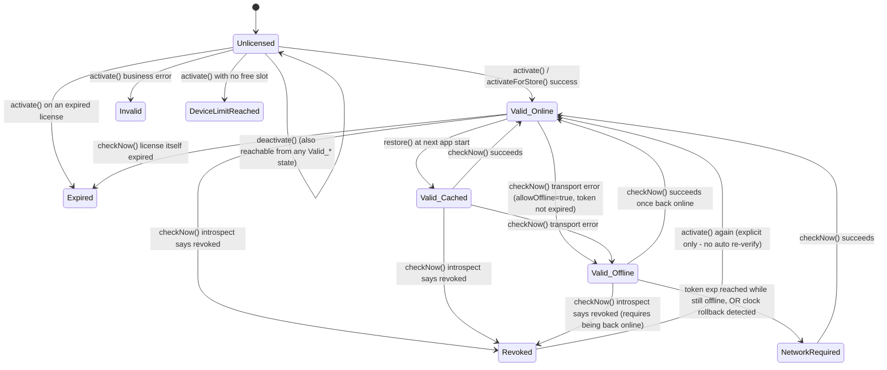

# License Lifecycle and Offline Grace

## States

Every public `LicenseClient` call returns a `LicenseState` (`core/src/commonMain/.../LicenseState.kt`)
instead of throwing. These are the only states that exist:

| State | Meaning | Recommended UI |
|---|---|---|
| `Unlicensed` | No activation attempted yet, or the last one failed before producing another state | Show an activation screen |
| `Valid(info, Mode.Online)` | Confirmed by a successful call just now | Full app access |
| `Valid(info, Mode.Cached)` | Confirmed by loading the cache at startup, before any network call this session | Full app access; this is the state right after `restore()` |
| `Valid(info, Mode.Offline(graceUntilEpochSeconds))` | Server unreachable; valid only until the cached token's own `exp` | Full app access + a subtle "offline" indicator; **do not** let the user believe offline grace is unlimited |
| `Revoked` | This device's token was revoked server-side (released from another device, or by an admin) | Force re-activation; explicit re-activate only, no auto re-verify (confirmed product decision) |
| `Expired` | The license itself (not just the token) has expired | Prompt for renewal |
| `DeviceLimitReached` | No free device slot was available on `activate` | Tell the user to release a device first, or contact support |
| `Invalid(reason, detail)` | Backend rejected the request or the token failed local verification | See `error-codes-reference.md` for `reason` -> user-facing copy |
| `NetworkRequired` | Online check is required to make progress (offline grace exhausted, or a clock-rollback was detected) | Block on "connect to the internet to continue" |

## State transitions

(`Valid_Online`/`Valid_Cached`/`Valid_Offline` above are the three `LicenseState.Valid.Mode`
values; they're drawn as separate nodes only for diagram clarity - at runtime all three are the
same `LicenseState.Valid` type.)

## Offline grace - the numbers that actually matter

Offline grace is **bounded by the cached token's own `exp` claim** - the SDK never extends it
locally (`OfflineGracePolicy.decide()`). Default token lifetime, set server-side, is
`max(2 * LicenseCheckIntervalMinutes, 30)` minutes. So with the backend's default 60-minute check
interval, a device that goes offline right after a successful check has **up to ~120 minutes**
before it's forced back to `NetworkRequired` - not indefinitely, and not reset by restarting the
app (the grace window is tied to the token's `exp`, which is a fixed point in time, not a
"time since last offline" counter).

If a device needs to run offline for longer than that (e.g. a kiosk with no reliable network),
the product path is an **admin-mediated offline activation** (`importOfflineToken(jwt)`), which
imports a token issued out-of-band with its own, longer `exp` - not a client-side setting to
"allow more offline time". There is no SDK API to extend grace beyond the token's signed `exp`;
that would defeat the point of signing it.

`allowOffline` itself (whether offline grace applies at all) comes from the backend's `/settings`
endpoint, fetched by the *integrating app* (which knows its own `orgId`/`storeId`) - not something
`LicenseClient` fetches automatically. If `allowOffline` is false, any transport error during
`checkNow()` goes straight to `NetworkRequired`, regardless of how much time is left on the token.

## Clock rollback

While offline, `ClockRollbackGuard` detects the system clock jumping backward by more than 5
minutes versus the highest time this device has ever observed. If tripped, offline grace is
disabled immediately (`NetworkRequired`) until the next successful online check - this is the
cheapest defense against "turn the clock back to dodge token expiry" and is checked on every
`checkNow()`, not just once. A forward clock jump has no special handling (it just makes the
token look closer to expiry, which is already the token's own concern).

## Revocation

Revocation is detected via `token/introspect` on the next `checkNow()` - there is no push
mechanism; a revoked device keeps working (within its already-bounded offline grace) until its
next check. Introspection runs *before* the SDK's own refresh-or-reuse decision specifically so a
revoked device stops as soon as it's next reachable, rather than riding out the cached token's
full `exp`. Once revoked, the cache is cleared and the state stays `Revoked` until the user
explicitly calls `activate()`/`activateForStore()` again - there is no automatic re-verify
(confirmed product decision; a `Revoked` device does not silently try to re-activate itself).

## Deactivation

`deactivate()` calls the backend's `release` endpoint for this device, then clears the local
cache - a transport failure during this call leaves the current state and cache untouched (so the
caller can retry; the device isn't left in limbo). If the backend says the device was already
released (error code 17, `DEVICE_NOT_FOUND`), the SDK treats that as success rather than an error
- it means another path already achieved the same end state.
